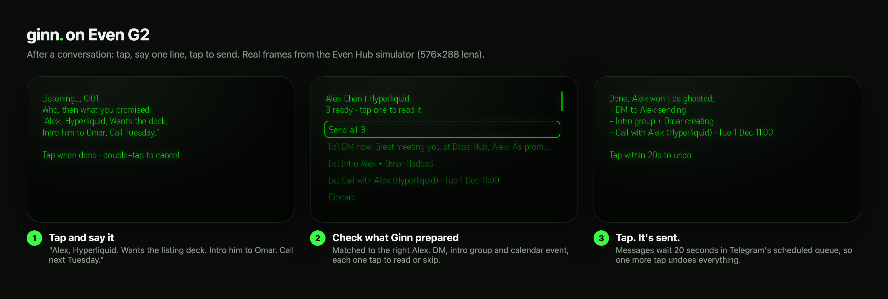
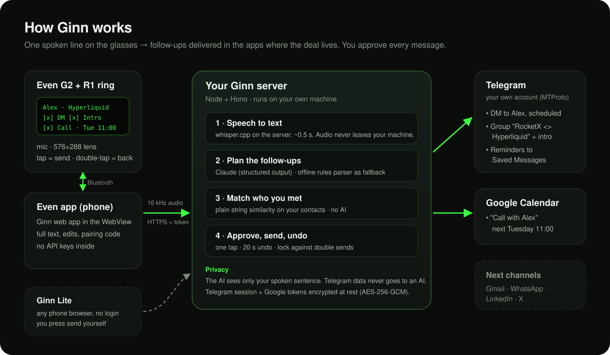
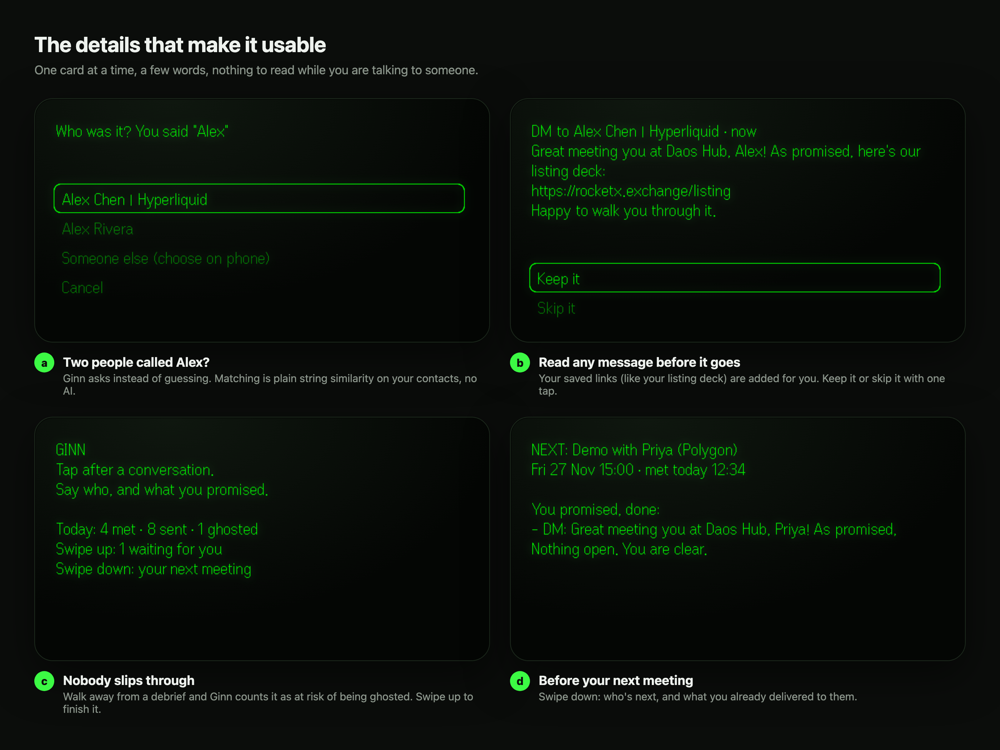
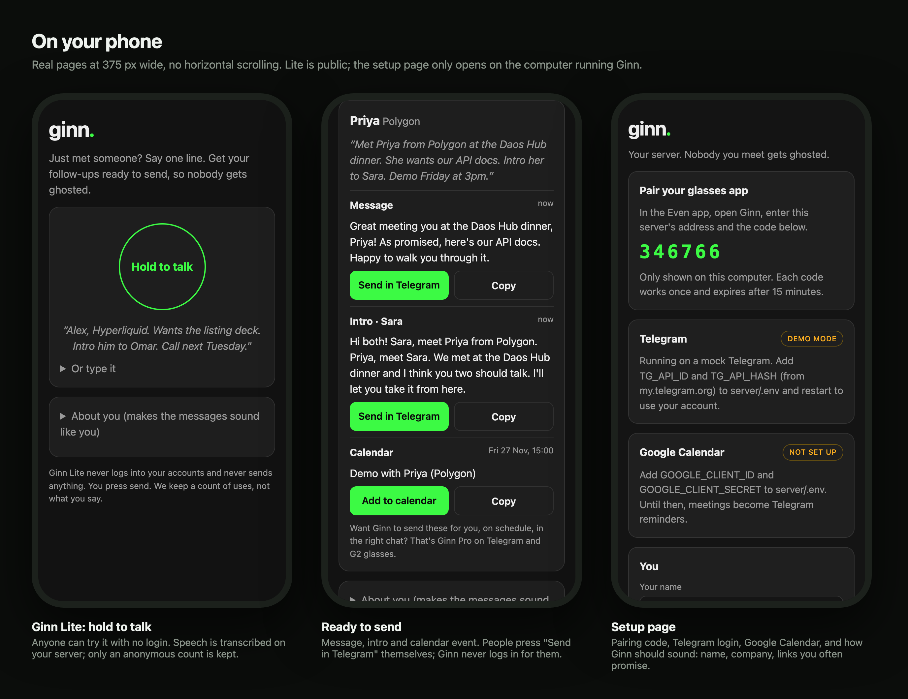

<p align="center">
  
</p>

<h3 align="center">Nobody means to ghost the people they meet. Ginn makes sure you don't.</h3>

<p align="center">
  Tap your Even G2 after a conversation, say one line, and the follow-ups go out<br>
  in Telegram and your calendar. One tap to approve. 20 seconds to undo.
</p>

<p align="center">
  <a href="https://github.com/Sakibimam/Ginn/actions/workflows/ci.yml"></a>
  
  
  
</p>

<p align="center"></p>

---

## The moment

You're at an event. You just talked to Alex from Hyperliquid. You promised him your listing deck, an intro to Omar,
and a call next week. Then the next person walks up, and by tonight it's one of thirty conversations you meant to follow up on.

With Ginn you tap the glasses and say:

> **"Alex, Hyperliquid. Wants the listing deck. Intro him to Omar. Call next Tuesday."**

Ginn prepares, and waits for one tap:

| What happens | Where |
|---|---|
| A DM to Alex from **your own account**, with your deck link, scheduled so you can undo | Telegram |
| A group **"RocketX <> Hyperliquid"** with Alex, Omar and an intro line (invite link if Omar blocks group adds) | Telegram |
| **"Call with Alex (Hyperliquid)"**, Tuesday 11:00 | Google Calendar |

At the end of the day the lens shows `14 met · 31 sent · 0 ghosted`. Swipe down before your next meeting to see what you
already delivered to that person.

## How it works

<p align="center"></p>

1. **Capture.** The G2 mic streams 16 kHz audio while you hold the conversation in your head for five seconds.
2. **Transcribe.** whisper.cpp on your own server, with the model kept loaded. Audio never leaves your machine.
3. **Plan.** Claude turns your sentence into actions with structured output. Without an API key, a built-in rules
   parser handles the same patterns offline.
4. **Match.** The name you said is matched to your Telegram contacts with plain string similarity. Two people called
   Alex? Ginn asks. No contact data ever reaches an AI.
5. **Approve.** One tap sends everything. Each message waits in Telegram's own scheduled queue for 20 seconds, so a tap undoes it.

<p align="center"></p>

## On your phone

<p align="center"></p>

- **Ginn Lite** (`/lite`) lets anyone try it with no login: hold to talk, then press "Send in Telegram" or "Add to calendar" yourself.
  `/lite?say=...` runs a dictated line directly, so an iPhone Shortcut or the Action Button can feed it.
- **The setup page** (`/`) is where you log in to Telegram, connect Google Calendar, get the pairing code and tell Ginn
  how to sound. It only opens on the computer running Ginn.
- **The phone panel** inside the Even app shows every message in full so you can edit it before it goes.

## Quick start

You can run the whole flow in five minutes with no accounts. Ginn starts on a mock Telegram and the offline parser.

```bash
# requirements: Node 20+, ffmpeg and whisper.cpp
brew install ffmpeg whisper-cpp
mkdir -p ~/.cache/whisper && curl -L -o ~/.cache/whisper/ggml-small.en.bin \
  https://huggingface.co/ggerganov/whisper.cpp/resolve/main/ggml-small.en.bin

# 1. server
cd server && npm install && cp .env.example .env && npm start
#    → setup page on http://localhost:8787, pairing code in the terminal

# 2. glasses app
cd ../glasses && npm install && npm run dev

# 3. simulator (uses your computer's microphone)
npm i -g @evenrealities/evenhub-simulator
evenhub-simulator http://localhost:5173
```

Click the lens to start, speak, click again. No mic? Open
`http://localhost:5173/?say=Alex,%20Hyperliquid.%20Wants%20the%20deck.` and every capture uses that line.

### Connect your real accounts

| | How | Without it |
|---|---|---|
| **Telegram** | Create an app at [my.telegram.org](https://my.telegram.org), set `TG_API_ID` / `TG_API_HASH`, restart, log in on the setup page (phone → code → 2-step password). Use a secondary account for demos. | Mock Telegram; see what would have been sent on the setup page |
| **Claude** | `ANTHROPIC_API_KEY` in `server/.env` | Offline rules parser |
| **Google Calendar** | OAuth web client (testing mode), redirect `<PUBLIC_URL>/auth/google/callback`, then "Connect" on the setup page | Meetings become Telegram reminders |

### On a real G2

```bash
cloudflared tunnel --url http://localhost:8787            # or any HTTPS tunnel
# server/.env → PUBLIC_URL=https://<your-tunnel>
cd glasses && GINN_SERVER_URL=https://<your-tunnel> npm run pack   # → ginn.ehpk
```

Install `ginn.ehpk` with the Even Hub CLI, open Ginn in the Even app and pair with the code from the setup page.

## Configuration

Everything lives in `server/.env` (see [`.env.example`](server/.env.example)) or on the setup page. Nothing personal is hard-coded.

| Setting | Default | |
|---|---|---|
| Name, company, where you are | empty | Used in messages and intro group names |
| `GINN_UNDO_SECONDS` | 20 | How long every message waits so you can undo |
| `GINN_MAX_LISTEN_SECONDS` | 45 | Longest debrief |
| Meeting hour / length | 11:00 / 30 min | When you say a day without a time |
| Intro group name | `{me} <> {them}` | Template |
| Saved links | none | e.g. `listing deck = https://...`, added when you promise it |
| `GINN_LITE_MAX_PER_HOUR` / `_PER_IP_PER_HOUR` | 200 / 20 | Caps on the public Lite page |
| `WHISPER_MODE` | `server` | Keeps the model loaded; `cli` runs per request |

## Security and privacy

Ginn sends messages as you, so it's built to be careful.

- **No Telegram data goes to an AI.** The model sees only the sentence you spoke and your own settings. Contact matching is plain code on your server.
- **Nothing reaches another person without your tap**, and every message can be undone for 20 seconds.
- **No keys in the app.** The `.ehpk` holds only your server's address. API keys, the Telegram session and Google tokens stay on the
  server; the session and tokens are encrypted at rest (AES-256-GCM). Data files are owner-only (`0600`).
- **Pairing.** Remote devices need a token, obtained with a 6-digit code that works once, expires after 15 minutes and locks out after 5 wrong tries.
  Tokens are compared in constant time.
- **The setup page and Google sign-in only work on the server's own machine**; through a tunnel they redirect or refuse.
- **Input is validated** on every route (zod), bodies are size-limited (8 MB audio, 64 KB JSON), and login attempts are rate-limited.
- **Ginn Lite is public but capped** per IP and per hour, and stores only an anonymous count, never what people say.
- **Safe under double taps:** a draft can't be sent twice even if the glasses and the phone both press send.
- **Survives restarts:** intros waiting in the undo window are finished when the server comes back.

## Performance

Measured on an M4 MacBook with `ggml-small.en`:

| | Time |
|---|---|
| Spoken debrief → planned follow-ups (7 s of audio) | **0.4–0.5 s** |
| Four people talking to Lite at once | all done within **1.6 s** |
| Typed debrief → plan | 16 ms |
| Lens screen change | one container rebuild; text updates in place |

The lens never waits forever: every request has a deadline (15 s, or 90 s for audio) and shows what went wrong.
The undo window is checked against the clock when you tap, so it stays correct even if the phone pauses timers in your pocket.

## Tests

```bash
cd server && npm test      # 42 checks
```

They cover parsing people, companies and events, intros, dates and day-parts, name matching (two Alexes, misheard names),
the full approve → deliver → undo flow on the mock, double-send protection and locked drafts. CI typechecks both apps,
runs the tests and builds the glasses app on every push.

## Project layout

```
glasses/   Even Hub app: lens screens (lens.ts), flow (main.ts), phone panel (phone.ts), API client
server/    Node + Hono: speech to text, parser, matcher, engine, Telegram + mock channels, Calendar, setup page, Lite
docs/      images in this README
```

## Built for Heads Up: Even Realities Hackathon

Main track **04 · AI Assistants & Work** (Claude + Google Calendar), second track **01 · Messaging** (Telegram account).

What existed before 2026-11-23: the glasses scaffold started from Even Realities' official `evenhub-templates/asr` template
(Vite config, `index.html`, the event-routing pattern), and open-source libraries (Even Hub SDK, GramJS, Hono, Anthropic SDK,
zod, chrono-node, luxon, whisper.cpp). Everything else was written during the hackathon week.

## Roadmap

- **Gmail**: same channel interface as Telegram
- **WhatsApp**: a pre-filled message you tap send on
- **LinkedIn and X** where their APIs allow
- Team view: shared intro templates and a pipeline for BD teams
